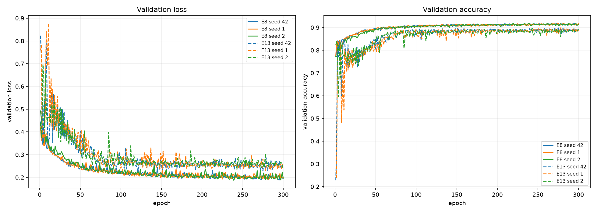

# U-Net reproduction on ISBI 2012 EM segmentation

A from-scratch PyTorch reproduction study of **U-Net: Convolutional Networks for Biomedical Image Segmentation** (Ronneberger, Fischer, and Brox, MICCAI 2015), focused on the ISBI 2012 neuronal membrane segmentation task.

This repository is not just a final model. It records the experimental path from a simplified padded U-Net to a paper-like unpadded network with overlap-tile inference, weighted loss, elastic deformation, dropout, and test-time augmentation.



## What is implemented

- 23-layer U-Net with configurable padded or valid convolutions.
- Center-cropped skip connections for the paper-like unpadded model.
- He initialization, SGD with momentum 0.99, batch size 1.
- Rotation, flipping, and elastic-deformation augmentation.
- Paper-inspired border weight maps for touching cells.
- Overlap-tile inference and eight-way rotation/flip TTA.
- Pixel error and foreground-restricted Rand error evaluation.
- Three-seed experiments and detailed ablation notes.

## Main findings

- The paper-like E13 configuration with TTA reached pixel error **0.0612 ± 0.0012** over three seeds, closely matching the paper's reported **0.0611**.
- Its Rand error was **0.0642 ± 0.0035**, above the paper's **0.0382**, so topology-sensitive performance was not fully reproduced.
- A simpler padded E8 configuration performed similarly on pixel error (**0.0619 ± 0.0023**) but better on Rand error (**0.0491 ± 0.0040**).
- This comparison changes three factors together—weighted loss, dropout, and padding/cropping—so it does not isolate a single cause.

These numbers come from repeated use of the released 30-image test labels during development. They document a reproduction study, not a fully independent final benchmark. Warping error is not implemented.

Full evidence and experiment chronology are in [experiments.md](experiments.md); architecture and paper-reading notes are in [notes.md](notes.md).

## Repository layout

```text
model.py          U-Net architecture
dataset.py        TIFF loading, augmentation, cropping, weight maps
configs.py        named best-empirical and paper-faithful configurations
train.py          command-line training entry point
tile.py           overlap-tile inference
metrics.py        pixel error, Rand error, and TTA
evaluate.py       command-line checkpoint evaluation
weights.py        paper-inspired border weight maps
experiments.md    full experiment log and conclusions
notes.md          paper notes and implementation decisions
analysis/         supporting metric and visualization checks
results/logs/     retained E8/E13 three-seed logs
```

## Setup

Python 3.10 or newer is recommended.

```bash
python3 -m venv .venv
source .venv/bin/activate
pip install -r requirements.txt
```

Download the ISBI 2012 challenge archive from the [ImageJ challenge page](https://imagej.net/events/isbi-2012-segmentation-challenge), then extract it so the repository contains:

```text
ISBI-2012-challenge/
  train-volume.tif
  train-labels.tif
  test-volume.tif
  test-labels.tif
```

The dataset is deliberately excluded from Git. Review its terms before redistribution.

## Run

Two named configurations are provided. The default is the empirically strongest E8 configuration:

```bash
python train.py --preset best_empirical --seed 42
```

For the paper-like E13 configuration with valid convolutions, weighted loss, and dropout:

```bash
python train.py --preset paper_faithful --seed 42
```

Repeat either command with seeds `1` and `2` to reproduce the repeated-run protocol. Checkpoints are written to `checkpoints/`, which is ignored by Git.

Evaluate a checkpoint with challenge-style pixel and foreground-restricted Rand errors. Eight-way TTA is enabled by default:

```bash
python evaluate.py \
  --checkpoint checkpoints/best_empirical_seed42_best_f1.pth \
  --preset best_empirical
```

Use `--no-tta` for evaluation without test-time augmentation. The preset must match the architecture used for training the checkpoint.

Useful checks:

```bash
python model.py
python tile.py
python dataset.py
python -m analysis.plot_logs
```

## Reproducibility notes

- The fixed validation split uses seed 42; training was repeated with seeds 42, 1, and 2. A seed is a reproducibility control, not a hyperparameter selected for performance.
- `best_empirical` corresponds to E8 (`padding=1`, no dropout, ordinary cross-entropy).
- `paper_faithful` corresponds to E13 (`padding=0`, dropout 0.5, paper-inspired weighted loss, overlap-tile inference).
- Apple MPS training showed small run-to-run numerical differences even with fixed seeds.
- The official Fiji foreground-restricted Rand convention was matched after implementation checks recorded in `experiments.md`.
- Large checkpoints, probability arrays, the paper PDF, and the dataset are intentionally omitted.

## References

- O. Ronneberger, P. Fischer, and T. Brox, “U-Net: Convolutional Networks for Biomedical Image Segmentation,” MICCAI 2015. [arXiv:1505.04597](https://arxiv.org/abs/1505.04597)
- [ISBI 2012 segmentation challenge archive and description](https://imagej.net/events/isbi-2012-segmentation-challenge)

## License

No software license has been selected yet. Add a `LICENSE` file before inviting reuse or contributions. The ISBI dataset and the U-Net paper are third-party materials and are not covered by any future code license for this repository.
